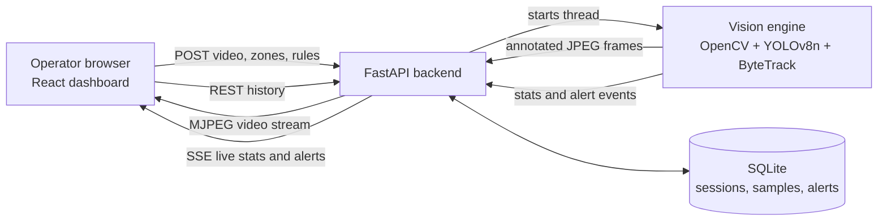

# CrowdSense: crowd density and bottleneck analytics

CrowdSense analyses recorded CCTV video and shows, on a live web dashboard, how many people are in each configured zone, where they gather (heatmap), how long they stay (dwell time) and when a zone exceeds its capacity (congestion alert).

Built for the Cogno Valley Vision AI internship, **Track A: Crowd density and bottleneck analytics**.

## Features (mapped to the Track A scope)

| Scope item | How it is implemented |
|---|---|
| Detect and track people | YOLOv8n (person class only) with ByteTrack, giving a persistent ID per person |
| Count occupancy in configured zones | Polygon zones drawn on the first frame. A person is inside a zone if their foot point (bottom-centre of the box) is inside the polygon |
| Density heatmap | Foot positions accumulated on a low-resolution grid, faded over time, blurred, drawn with a colour map. Relative, not absolute density |
| Movement velocity | Foot-point displacement over video time, smoothed. Units are **pixels per second** (no camera calibration) |
| Dwell time | Time since a track ID first appeared inside a zone. Average and maximum per zone |
| Threshold alerts | Over-capacity (critical) and long-dwell (warning). Each alert is raised once after a hold period and cleared once, never per frame |
| Dashboard | React, dark theme, live MJPEG video with overlays, zone gauges, headcount time-series, congestion banner, alert log |
| Events and history | Live events over Server-Sent Events. Alerts and per-second counts stored in SQLite and exposed through REST |

"Bottleneck" is interpreted here as a zone that is over capacity or where people stay longer than the configured dwell limit.

## Architecture



| Layer | Files | Responsibility |
|---|---|---|
| Image/video input | `engine.py` | Read video, skip frames, resize, attach video timestamps |
| Vision and rules | `engine.py` | Detection, tracking, zones, dwell, velocity, heatmap, alert state machine |
| Backend and storage | `main.py` | REST API, MJPEG and SSE streaming, validation, SQLite |
| Web dashboard | `frontend-src/` (built into `frontend/`) | Zone setup, live view, charts, alerts |

## Run it (Windows, CPU only)

```powershell
python -m venv venv
venv\Scripts\activate
pip install ultralytics opencv-python fastapi "uvicorn[standard]" python-multipart numpy
python -m uvicorn main:app --port 8000
```

Put videos in `samples/`, then open http://127.0.0.1:8000. API docs are at `/docs`.

To change the dashboard: `cd frontend-src`, `npm install`, `npm run build`, then copy `dist/*` into `frontend/`.

## API

| Method and path | Purpose |
|---|---|
| `GET /api/samples` | List videos in `samples/` |
| `POST /api/sessions` | Register a sample or uploaded video, returns `session_id` |
| `GET /api/sessions/{id}/preview` | First frame, used to draw zones |
| `POST /api/sessions/{id}/start` | Start analysis with zones and rules |
| `POST /api/sessions/{id}/stop` | Stop analysis |
| `POST /api/sessions/{id}/toggle` | Show or hide heatmap and boxes |
| `GET /api/sessions/{id}/stream` | Annotated video (MJPEG) |
| `GET /api/sessions/{id}/events` | Live stats and alerts (SSE) |
| `GET /api/sessions/{id}/timeseries` | Stored per-second counts |
| `GET /api/alerts` | Stored alerts |
| `GET /api/history` | Past sessions |

## Database

`sessions(id, name, started_at, config)`, `samples(id, session_id, video_time, total, zones_json)`, `alerts(id, session_id, zone, type, state, severity, count, capacity, video_time, created_at)`.

## Validation

Measured on my own hardware: **CPU only, Windows 11**. Fill in every row from your own runs before submitting.

| Video | Scene | Length | Manual count at checked times | System count | Alerts expected | Alerts observed |
|---|---|---|---|---|---|---|
| crowd1.mp4 | outdoor plaza, people close to camera | about 11 s | TODO | TODO | over-capacity at capacity 3 | raised at 2.1 s, cleared at 9.7 s |
| TODO | TODO | TODO | TODO | TODO | TODO | TODO |

Processing speed: roughly 11 to 14 processed frames per second with `yolov8n`, `imgsz=480`, processing every 3rd frame (measured during testing on this laptop).

## Limitations

- **Occlusion and overlap:** people hidden behind others are missed or merged, so counts are lower than reality in dense crowds.
- **Camera angle and distance:** small, distant people may be missed. Zone membership uses the foot point, which is wrong when feet are hidden.
- **Density is occupancy, not people per square metre.** Real density needs camera calibration, which is not done here.
- **Velocity is in pixels per second** and depends on perspective.
- **Heatmap is relative:** red means the busiest spot in this video, not an absolute level.
- **Low light and low resolution** reduce detection confidence and cause missed people and ID switches.
- **Frame skipping** (every 3rd frame) trades some tracking precision for speed on CPU.
- Only one analysis runs at a time, and sessions are held in memory, so a server restart clears them.

## Open-source licences

Verify each licence on the project page before submitting.

| Component | Licence |
|---|---|
| Ultralytics YOLOv8 code and `yolov8n.pt` weights | AGPL-3.0 |
| ByteTrack (via Ultralytics) | MIT |
| PyTorch | BSD-style |
| OpenCV | Apache-2.0 |
| FastAPI, React, Recharts, Vite | MIT |
| Uvicorn | BSD-3-Clause |
| SQLite | Public domain |
| Manrope font | SIL Open Font Licence |
| Demo videos | TODO: list each source and its licence (for example Pexels licence) |

Because Ultralytics is AGPL-3.0, this project's source is published openly in this repository.
